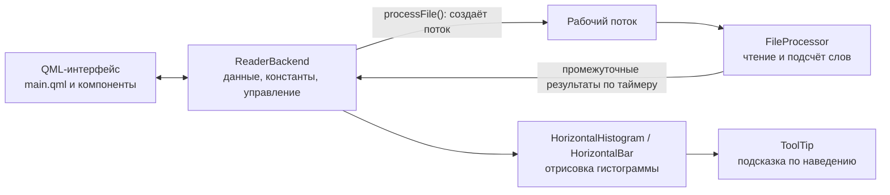

# XarconleReader

> **Это небольшой тестовый проект**, выполненный в рамках тестового задания. Он показывает подход к решению задачи и не претендует на роль готовой функциональной программы.

Небольшая программа на **C++ / QML (Qt)**, которая подсчитывает частоту слов в текстовом файле и в реальном времени показывает **топ-15** самых частых слов в виде гистограммы.

## Возможности

- выбор файла и запуск обработки;
- фильтр по минимальной длине слова: учитываются только слова не короче заданной длины;
- чтение файла в отдельном потоке, интерфейс не зависает на больших файлах;
- пауза, продолжение, остановка и отмена обработки;
- живое обновление гистограммы топ-15 в процессе чтения;
- подсказка при наведении на столбец: слово и количество вхождений.

## Как это устроено



### Классы C++

| Класс | Назначение |
|---|---|
| `ReaderBackend` | Связующее звено между QML и C++: передаёт в QML основные данные и константы, управляет обработкой. Функция `processFile()` создаёт поток, помещает в него новый экземпляр `FileProcessor` и запускает обработку выбранного файла. |
| `FileProcessor` | Обрабатывает файл (запускается функцией `run()`) и поддерживает топ-15 слов. |
| `HorizontalHistogram`, `HorizontalBar` | Отрисовка гистограммы. |
| `ToolTip` | Подсказка с текущим количеством вхождений слова и самим словом при наведении на элемент. |
| `Defs.h` | Значения констант, используемых в проекте. |

### Алгоритм работы `FileProcessor`

1. Открыть файл, создать и запустить таймер.
2. Пока файл не прочитан целиком:
   - проверить таймер и при необходимости отправить текущие результаты в `ReaderBackend` (он передаёт их QML-элементам);
   - при паузе или остановке выполнить соответствующее действие;
   - считать очередное слово и обработать его;
   - обновить топ-15.

### Компоненты QML

| Файл | Назначение |
|---|---|
| `main.qml` | Основной файл, описывает структуру приложения |
| `BetterButton.qml` | Кнопка |
| `FileRow.qml` | Строка с выбранным файлом |
| `OpenStartRow.qml` | Строка с кнопками «Открыть» и «Старт» |
| `PauseCancleRow.qml` | Строка с кнопками «Продолжить», «Остановить» и «Отменить» |
| `LengthRow.qml` | Выбор минимальной длины слова, для которого считается количество вхождений |
| `WelcomeText.qml` | Краткая справка по работе приложения |

## Структура проекта

```
.
├── CMakeLists.txt
├── main.cpp, main.qml
├── ReaderBackend.{h,cpp}
├── FileProcessor.{h,cpp}
├── HorizontalHistogram.{h,cpp}
├── HorizontalBar.{h,cpp}
├── ToolTip.{h,cpp}
├── Defs.h
└── *.qml                      # компоненты интерфейса
```

## Сборка

Требования:

- Qt **6.2** или новее (модули Core, Quick, Widgets);
- CMake **3.16** или новее;
- компилятор с поддержкой C++17 (требование Qt 6).

```bash
cmake -S . -B build -DCMAKE_PREFIX_PATH=<путь к установленному Qt>
cmake --build build
```

## Запуск

1. Запустите приложение: `build/appXarconleReader` (в Windows при сборке через Visual Studio — `build/Debug/appXarconleReader.exe` или `build/Release/appXarconleReader.exe`).
2. Нажмите «Открыть» и выберите текстовый файл.
3. При необходимости задайте минимальную длину слова.
4. Нажмите «Старт». Во время обработки доступны «Продолжить», «Остановить» и «Отменить».